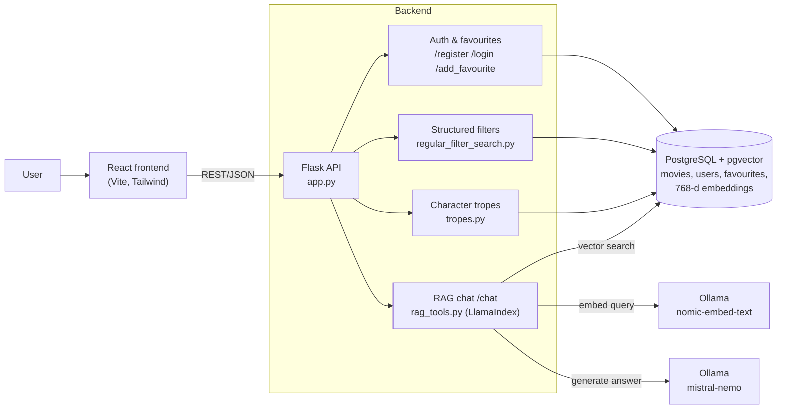

# Popcorn Not Included

**A movie discovery web app that combines a local-LLM "ask me anything" movie chat (RAG over pgvector) with precise structured filters, community character tropes and personal favourites.**

<!--
Screenshots: add images to docs/screenshots/ and uncomment this table.
| Home | AI movie chat | Filters & results |
|---|---|---|
|  |  |  |
-->

## Features

- **AI movie chat (RAG):** describe what you feel like watching in natural language. Movie descriptions are embedded with `nomic-embed-text`, stored in PostgreSQL + pgvector, retrieved with LlamaIndex and answered by a local `mistral-nemo` model through Ollama. No paid API, and everything runs locally.
- **Structured search:** filter by genre, release year, director, rating and keywords, or combine them all in one query (SQL-backed, sorted by rating).
- **Character tropes:** users can tag movies with character tropes and browse movies by trope.
- **Accounts & favourites:** register/login with JWT-based sessions, save favourites, delete account.
- **React frontend:** Vite + React 19 + Tailwind, with dark mode, skeleton loaders, pagination and a pinned search bar.
- **Tested backend:** pytest suites for filters, movies, users, tropes and RAG.

## Architecture



## How to run

**Prerequisites:** Docker, [Ollama](https://ollama.com/download), Python 3.10+, Node 18+.

1. Start PostgreSQL with pgvector:
   ```sh
   docker run -e POSTGRES_USER=myuser \
              -e POSTGRES_PASSWORD=mypassword \
              -e POSTGRES_DB=mydatabase \
              --name my_postgres -p 5432:5432 -d ankane/pgvector
   ```
2. Pull the local models:
   ```sh
   ollama pull mistral-nemo:latest
   ollama pull nomic-embed-text:latest
   ```
3. Configure the environment: copy `.env_example` to `.env` and fill in the values.
4. Run the backend:
   ```sh
   cd backend
   pip install -r requirements.txt
   python app.py
   ```
5. Run the frontend (in a second terminal):
   ```sh
   cd frontend
   npm install
   npm run dev
   ```
6. Run the tests:
   ```sh
   cd backend
   pytest
   ```

## Results

| Metric | Baseline (vector search) | + Cross-encoder reranking |
|---|---|---|
| Top-1 retrieval accuracy | 50% | **76%** |

## Tech stack

**Backend:** Python, Flask, SQLAlchemy, PostgreSQL, pgvector, LlamaIndex, Ollama (mistral-nemo, nomic-embed-text), PyJWT, pytest
**Frontend:** React 19, Vite, Tailwind CSS, React Router, Framer Motion

## Team

Team project for **Applied Programming for AI**, VU Amsterdam (**2025**).
Team: Antonia Bulai, David-Valentin Neacșu, Laetitia Maria Rossetti, Goktug Yildirim.

**My contributions:** I built the structured movie-filtering backend (genre, year, director, rating and keyword filters, later migrated from CSV to SQL with a combined-filter query), wrote its test suite, built a React frontend prototype (home, search, auth and favourites pages), and helped shape the concept during brainstorming.

This repository is a copy of the original course repository with full commit history. Secrets were removed from history before publishing.

## License

[MIT](LICENSE)
